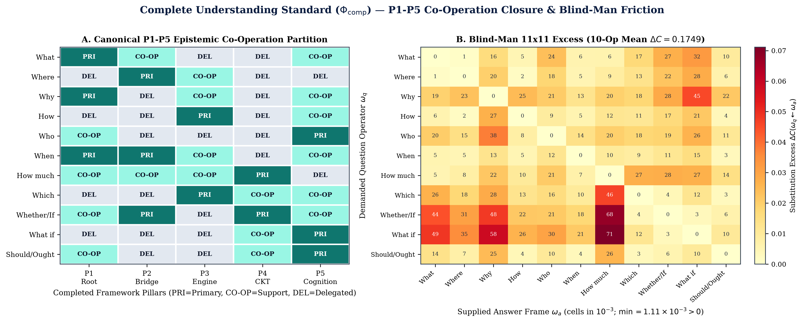
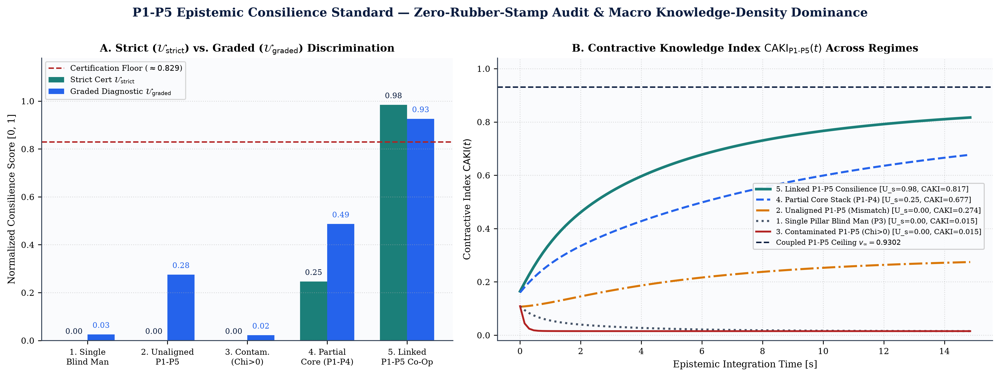

# Complete Understanding & Epistemic Consilience Standard (`Φ_comp`, `v1.1`)

* **Standard PDF:** [`Complete_Understanding_and_Epistemic_Consilience_Standard_v1.1.pdf`](Complete_Understanding_and_Epistemic_Consilience_Standard_v1.1.pdf)
* **Validation Script:** [`validate_consilience_standard.py`](validate_consilience_standard.py)
* **Author:** Mohamed Gamal Eldin Abdelaziz Noureldin ([ORCID: 0009-0006-3991-1153](https://orcid.org/0009-0006-3991-1153))
* **Container Project:** [The Conciseness Framework](../README.md)

## Abstract & Core Scope

Drawing on the parable of *The Blind Men and the Elephant*, this cross-pillar specification formalizes **Complete Operational Understanding ($\Phi_{\mathrm{comp}}(X)$)** downstream of Pillar 1's immutable Minimal Existential Understanding ($\Phi \equiv \exists X\mathcal{D}(X)$, `v2.10` preserved verbatim). Rather than collapsing understanding into any isolated perspective, $\Phi_{\mathrm{comp}}(X)$ evaluates all **eleven canonical Question Operators** ($\mathcal{Q}_\omega$: *What, Where, Why, How, Who, When, How much, Which, Whether/If, What if, Should/Ought*, **Pillar 5 `v4.1`**) across the $1+3$ Domain Architecture (**Pillar 2 `v2.0`**) under **zero internal contradiction ($\chi_{\mathrm{contra}} = 0$)** and **minimum Mercy–Time interface friction ($\mathcal{C}_{\mathrm{friction}} \le \varepsilon_{\mathcal{M}}$)**.

## Verified Audits (`validate_consilience_standard.py`)

| Check / Theorem | Core Quantitative Guarantee | Verified Live Result |
| :--- | :--- | :--- |
| **11×11 Blind-Man Excess (`Thm 2.1`)** | Strictly positive Pareto substitution penalty across all $110$ mismatched operator pairs (`B_energy = 11.0`). | `min = 0.001109`, `mean = 0.017491`, `max = 0.071107`, 10-op mean `0.174912` (`PASS`) |
| **5×11 P1–P5 Co-Operation Matrix (`Thm 2.2`)** | Every operator resolved by Primary (`PRI`) / Co-Operating (`CO-OP`) pillars; inanimate `P2–P4` delegate (`DEL`) `Who`. | `11/11` operators covered (`C_min = 1.0000` across `P1–P5`, `PASS`) |
| **Strict vs. Graded Regimes (`Def 1.1`)** | Distinguishes single-pillar overreach, unaligned mismatch, contradiction contamination ($\chi > 0$), and partial `P1–P4` from linked `P1–P5`. | `Linked P1–P5`: `U_strict = 0.9841`, `U_graded = 0.9259`, `CAKI = 0.8167 < 0.9302` (`PASS`) |
| **Primary Literature Corpus** | Consolidated P1–P5 arXiv metadata manifest (`literature-search-arxiv`). | `211` unique live-verified arXiv papers verified in `../citations/` (`PASS`) |

## Reproducibility & Figures

```bash
python validate_consilience_standard.py
```




