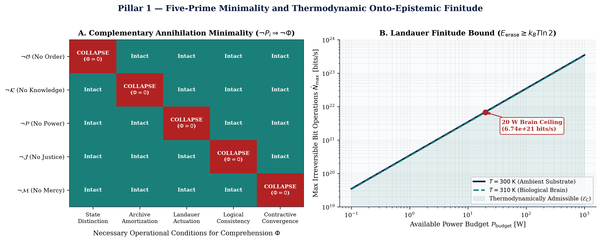
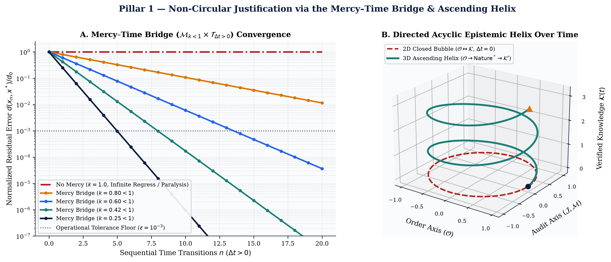

# Pillar 1: The Foundation of Knowledge Theory (`v2.10`)

* **Monograph PDF:** [`The_Foundation_of_Knowledge_Theory_v2.10.pdf`](The_Foundation_of_Knowledge_Theory_v2.10.pdf)
* **Validation Script:** [`validate_pillar1_foundation.py`](validate_pillar1_foundation.py)
* **Author:** Mohamed Gamal Eldin Abdelaziz Noureldin ([ORCID: 0009-0006-3991-1153](https://orcid.org/0009-0006-3991-1153))
* **Container Project:** [The Conciseness Framework](../README.md)

## Abstract & Core Scope

**The Foundation of Knowledge Theory (Version 2.10)** serves as the immutable ontological and epistemological root of *The Conciseness Framework*. With zero forward references to downstream domain monographs, it dismantles Agrippa's Trilemma, resolves radical doubt, Hume/Al-Ghazali's problem of induction, the First-Cause regress, Kant's noumenal veil, and Gettier's JTB fracture, and grounds the **Triad of Balance** unifying Empirical Science, Analytic Philosophy, and Rational Theology.

## Verified Theorems & Mathematical Audits

| Section / Theorem | Core Formal Claim | Verification Method in `validate_pillar1_foundation.py` |
| :--- | :--- | :--- |
| **§§2.2–2.5 (`Thm 2.2`)** | Performative undeniability of Understanding ($\Phi$), Event separation ($e_1 \neq e_2$), and $\mathrm{NeedsCause}(x) \iff x \in \mathcal{E}_C$ exempting Non-Event $\mathcal{E}_A \notin \mathcal{E}_C$. | State-transition predicate separation over contingent events vs. uncaused ground $\mathcal{E}_A$. |
| **§3.4 (Modal B/S5)** | $\Box(\mathcal{S}_N \Rightarrow \Box\mathcal{S}_N) \wedge \neg\mathcal{S}_N(w_@) \vdash \Box\neg\mathcal{S}_N \vdash \Box\mathcal{E}_A$ deriving *The First* and *The Everlasting*. | Exhaustive finite Kripke frame checker across **238** reflexive-symmetric models ($\|W\|\le 4$, 0 counterexamples). |
| **§3.5 (Landauer)** | Contingent finitude ($\mathcal{P}_{\mathrm{budget}} < \infty$) coupled via Landauer's principle $E_{\mathrm{erase}} \ge k_B T \ln 2$. | Thermodynamic bit-rate horizon evaluation ($\approx 6.742\times 10^{21}$ bits/s at $20\text{ W}, 310\text{ K}$). |
| **§§4.1–4.2 (`Thm 4.1–4.2`)** | Transcendental deduction of $\mathcal{P}_C = \{\mathcal{O}, \mathcal{K}, \mathcal{P}, \mathcal{J}, \mathcal{M}\}$ via Complementary Annihilation ($\neg P_i \Rightarrow \neg\Phi$). | Full-rank ($5\times 5$, $\det=1$) minimality matrix and multiplicative collapse check. |
| **§§4.5–4.6 (`Thm 4.3`)** | Exclusive Infinite-to-Finite Mercy–Time Bridge ($\mathcal{M}_{k<1} \times \mathcal{T}_{\Delta t > 0}$) and 3D Ascending Epistemic Helix. | Numerical quadrature of $E_{\mathrm{val}}(\varepsilon) = c_0\ln(1/\varepsilon)$, Banach contraction ($k < 1$ vs. $k=1$), and 3D helical ascent. |

## Reproducibility & Figures

```bash
python validate_pillar1_foundation.py
```




