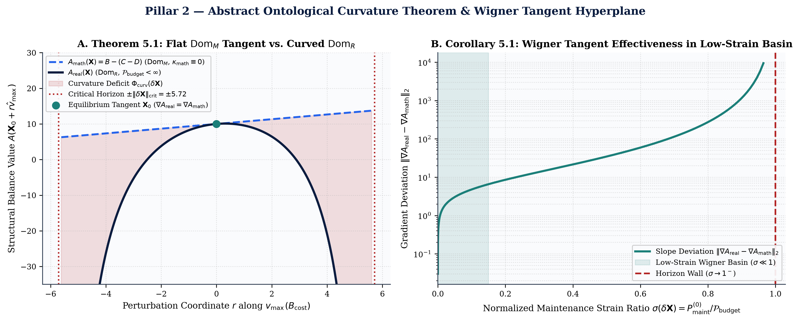
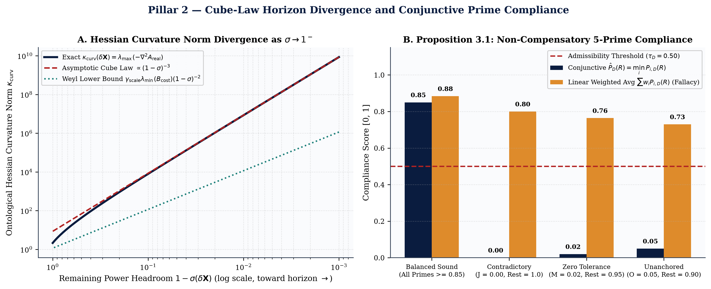

# Pillar 2: The Finite Infinity Framework (`v2.0`)

* **Monograph PDF:** [`The_Finite_Infinity_Framework_v2.0.pdf`](The_Finite_Infinity_Framework_v2.0.pdf)
* **Validation Script:** [`validate_pillar2_finite_infinity.py`](validate_pillar2_finite_infinity.py)
* **Author:** Mohamed Gamal Eldin Abdelaziz Noureldin ([ORCID: 0009-0006-3991-1153](https://orcid.org/0009-0006-3991-1153))
* **Container Project:** [The Conciseness Framework](../README.md)

## Abstract & Core Scope

**The Finite Infinity Framework (Version 2.0)** builds the practical epistemic bridge between Pillar 1's ontological root and bounded scientific/mathematical modeling. It formalizes **Finite Infinity** (*"stopping finitely, infinitely often"*), the **$1+3$ Domain Architecture** ($\mathrm{Dom}_R$ vs. $\{\mathrm{Dom}_P, \mathrm{Dom}_M, \mathrm{Dom}_C\}$), non-compensatory representation compliance $\hat{P}_D(R)$, the operational resolution floor ($\delta_{\mathrm{act}}, \Delta t_{\min} > 0$), **Abstract Ontological Curvature** ($B_{\mathrm{cost}} \succ 0$, $\|\delta\mathbf{X}\|_{\mathrm{crit}}$), **Beginning-System Finitude**, and an 8-benchmark paradox diagnostic suite backed by `40` verified arXiv primary works.

## Verified Theorems & Mathematical Audits

| Section / Theorem | Core Formal Claim | Verification Method in `validate_pillar2_finite_infinity.py` |
| :--- | :--- | :--- |
| **Prop 3.1** | Representation-typed conjunctive compliance $\hat{P}_D(R) := \min_{i\in\mathcal{P}_C} P_{i,D}(R)$ prevents zero-Prime pathologies from hiding behind averages. | Evaluated across 4 Prime pathology profiles (0.00 min vs. 0.80 linear average fallacy). |
| **Thm 5.1 & Cor 5.1** | Flat affine math $A_{\mathrm{math}}(\mathbf{X})$ acts as exact tangent hyperplane at $\mathbf{X}_0$ ($\nabla A_{\mathrm{real}} = \nabla A_{\mathrm{math}}$), while finite-budget strain forces $(1-\sigma)^{-3}$ Hessian curvature divergence at $\|\delta\mathbf{X}\|_{\mathrm{crit}}$. | Complex-step differentiation (`grad_err = 1.78e-15`, `hess_err = 8.88e-16`), exact $\kappa_{\mathrm{graph}}(\mathbf{0}) = 0.210000$, horizon $\|\delta\mathbf{X}\|_{\mathrm{crit}} = 5.7160$, and $(1-\sigma)^{-3}$ asymptote check. |
| **Thm 5.2–5.3** | Exhaustive Dissipation vs. Phase Transition bifurcation at horizon and non-perpetuity of contingent beginning systems. | Energetic ceiling & finite-step Horizon termination bounds. |

## Reproducibility & Figures

```bash
python validate_pillar2_finite_infinity.py
```




