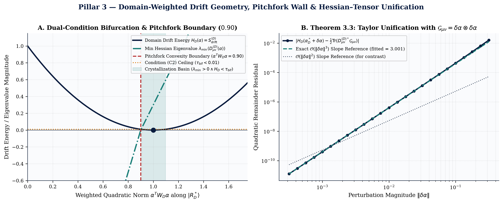
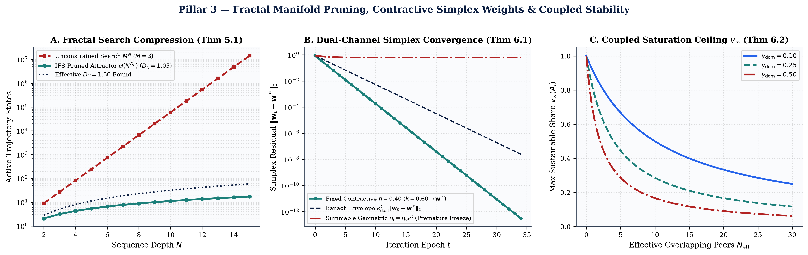

# Pillar 3: The Actualization Theory (`v6.0`)

* **Monograph PDF:** [`The_Actualization_Theory_v6.0.pdf`](The_Actualization_Theory_v6.0.pdf)
* **Validation Script:** [`validate_pillar3_actualization.py`](validate_pillar3_actualization.py)
* **Author:** Mohamed Gamal Eldin Abdelaziz Noureldin ([ORCID: 0009-0006-3991-1153](https://orcid.org/0009-0006-3991-1153))
* **Container Project:** [The Conciseness Framework](../README.md)

## Abstract & Core Scope

**The Actualization Theory (Version 6.0)** formulates the domain-agnostic **Universal Dynamical Selection Engine** downstream of Pillars 1 and 2. It unifies Banach selection contraction ($T_M, k_D$), finite atomic Boolean ultrafilters ($\mathcal{B}_{\mathrm{fin}}, v^*$), post-actualization property emergence ($\Pi_{\mathrm{obs}}$), 5D Prime Hilbert orthant geometry ($\mathcal{H}_P^+ = \mathbb{R}_{\ge 0}^5$), domain-decoded Drift Hessians ($D_{\mu\nu}^{(D)}$), Dual-Condition Bifurcation, dimensionless stationary drift ($W_{\mathrm{caus}}, \mathcal{A}_{\mathrm{drift}}$), Bidirectional Fractal Transfer ($\mathcal{R}_\ell, \varphi$), and contractive dual-channel simplex stability ($\mathbf{w}_t \to \mathbf{w}^*$, $v_\infty$), positioned against `50` verified arXiv primary works.

## Verified Theorems & Mathematical Audits

| Section / Theorem | Core Formal Claim | Verification Method in `validate_pillar3_actualization.py` |
| :--- | :--- | :--- |
| **Thms 3.1–3.4** | Unique orthant equilibrium $|R_D^*\rangle$, exact canonical spectrum $\{0.4^4, 8.0\}$ ($\mathrm{Tr}=9.6$), pitchfork wall $\alpha^T W_D \alpha = 0.90$, pullback $B_{\mathrm{cost}}^{(D)} \succ 0$, cubic Taylor unification with $\mathcal{G}_{\mu\nu} = \delta\alpha \otimes \delta\alpha$, and Dual-Condition Bifurcation. | Exact spectral assertions, finite-difference Hessian check (`< 1e-6`), log-log cubic Taylor slope (`3.0013`), and basin classification. |
| **Thms 5.1–5.3** | Hutchinson IFS dimension $D_H = \ln(N)/\ln(1/k_D)$ compressing $M^N \to \mathcal{O}(N^{D_H})$ and exact Horizontal Isomorphic Pullback $\varphi$. | Exact pullback matrix identity $\|B_{\mathrm{tgt}}^{\mathrm{direct}} - B_{\mathrm{tgt}}^{\mathrm{pullback}}\| < 10^{-12}$ and $D_H = 1.0465$. |
| **Thms 6.1–6.2** | Contractive dual-channel simplex convergence $\mathbf{w}_t \to \mathbf{w}^*$ ($0 < \eta < 2/(L+\mu)$) eliminating geometric step-size freeze, plus coupled saturation ceiling $v_\infty \le (1 + \gamma_{\mathrm{dom}} N_{\mathrm{eff}})^{-1}$. | Verified geometric error decay (`3.01e-13` vs. `0.604` freeze) and multi-subsystem saturation curves. |

## Reproducibility & Figures

```bash
python validate_pillar3_actualization.py
```




