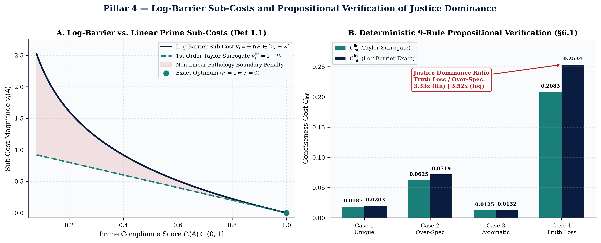
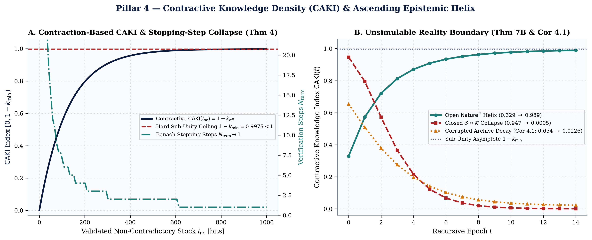

# Pillar 4: The Computational Knowledge Theory (`v4.0`)

* **Monograph PDF:** [`The_Computational_Knowledge_Theory_v4.0.pdf`](The_Computational_Knowledge_Theory_v4.0.pdf)
* **Validation Script:** [`validate_pillar4_ckt.py`](validate_pillar4_ckt.py)
* **Author:** Mohamed Gamal Eldin Abdelaziz Noureldin ([ORCID: 0009-0006-3991-1153](https://orcid.org/0009-0006-3991-1153))
* **Container Project:** [The Conciseness Framework](../README.md)

## Abstract & Core Scope

**The Computational Knowledge Theory (CKT, Version 4.0)** applies Pillars 1–3 to algorithmic representation cost, computational complexity compression, contractive knowledge density ($\mathrm{CAKI}$), Cardinal Value dynamics ($W, P, \Gamma_{\mathrm{crea}}, E$ and Landauer-bounded $P_{\mathrm{wisdom}}$ `[bits/s]`), and the **Principle of Unsimulable Reality** (`Theorems 7A–7B`). Backed by `50` verified arXiv works, it establishes why closed synthetic self-simulation collapses monotonically unless anchored to external mind-independent reality ($\mathrm{Nature}^*$).

## Verified Theorems & Mathematical Audits

| Section / Theorem | Core Formal Claim | Verification Method in `validate_pillar4_ckt.py` |
| :--- | :--- | :--- |
| **Prop 1.1 & Thm 3** | Log-barrier sub-costs $v_i = -\ln P_i$, Mean-Normalized Coarse-Graining ($\Delta^4 \to \Delta^2$) exact $\Delta_{\mathrm{JDC}}$ equivalence, multiplicative Vacuum-Brake duality, and Debreu–Aczél scalar uniqueness. | Verified to `< 1e-12` across 200 random 5-Prime profiles plus exact JDC simplex projection. |
| **Testbed A (§6.1)** | Deterministic 9-Rule Propositional Back-and-Forth Verification Loop cleanly separates truth loss from over-specification noise. | Exhaustive $2^{10}-1$ subset enumeration yielding **`3.3333x`** (linear) and **`3.5236x`** (log-barrier) truth-loss penalty ratio. |
| **Thms 4, 6 & Cor 4.1** | Contractive $\mathrm{CAKI}(t) = 1 - k_{\mathrm{eff}}(t) < 1 - k_{\min} < 1$, iteration collapse $N_{\mathrm{term}} \to 1$, zero *ex nihilo* ODE, corruption erosion, and Clarke right-derivative `Lemma E`. | Checked across `10,000` random states, exact $d\mathrm{CAKI}/dt$ (`< 1e-9`), and Clarke derivative (`< 1e-7`). |
| **Thms 7A–7B (§6.2)** | Closed $\mathcal{O}\leftrightarrow\mathcal{K}$ self-simulation collapses ($\mathrm{CAKI}_{\mathrm{closed}}: 0.9468 \to 0.0005$) whereas external $\mathrm{Nature}^*$ interaction ascends ($0.3287 \to 0.9893$). | Deterministic 15-epoch closed-loop collapse vs. open ascending epistemic helix trajectories. |

## Reproducibility & Figures

```bash
python validate_pillar4_ckt.py
```




