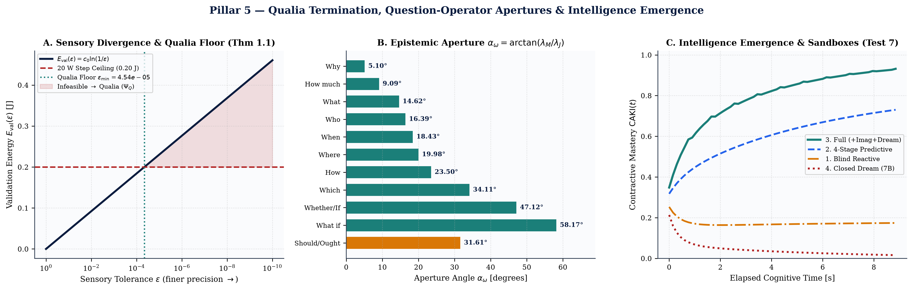
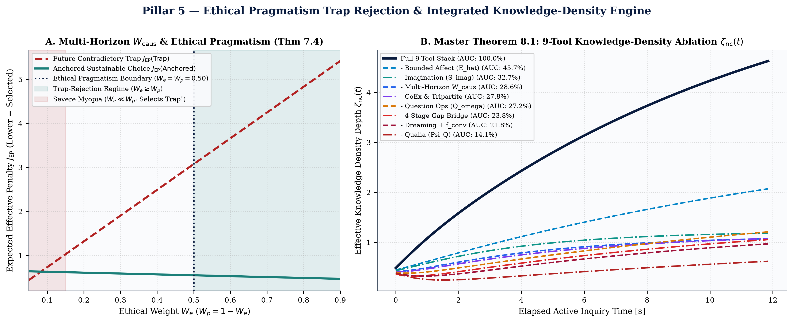
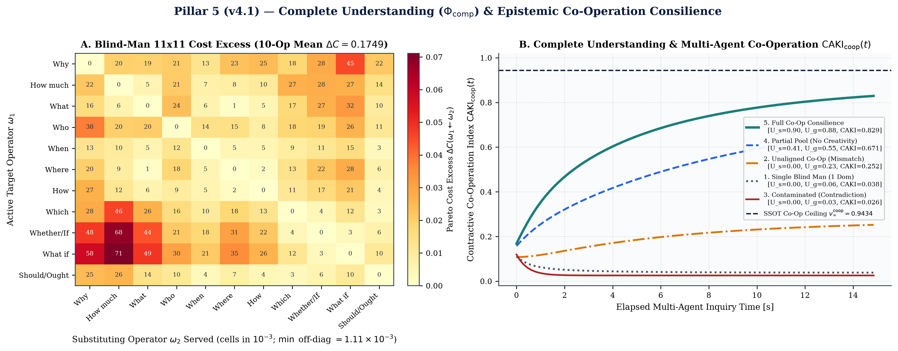

# Pillar 5: Consciousness Operations as Prime Reductions (`v4.1`)

* **Monograph PDF:** [`Consciousness_Operations_as_Prime_Reductions_v4.1.pdf`](Consciousness_Operations_as_Prime_Reductions_v4.1.pdf)
* **Validation Script:** [`validate_pillar5_consciousness.py`](validate_pillar5_consciousness.py)
* **Author:** Mohamed Gamal Eldin Abdelaziz Noureldin ([ORCID: 0009-0006-3991-1153](https://orcid.org/0009-0006-3991-1153))
* **Container Project:** [The Conciseness Framework](../README.md)

## Abstract & Core Scope

**Consciousness Operations as Prime Reductions (Version 4.1)** represents the Cognition Domain branch downstream of Pillars 1–4 (with strict zero dependence on cosmology or software engineering). It unifies Qualia boundary termination ($\Psi_Q$), the **Emergence of Intelligence** (4-stage predictive gap-bridging, top-down dynamic $\mathcal{P}_C$ resolution of panpsychism's combination problem, and bounded virtual sandboxes $\mathcal{S}_{\mathrm{imag}} / \mathcal{S}_{\mathrm{dream}}$), 11 non-commuting **Question Operators** ($\mathcal{Q}_\omega$) indexed by Epistemic Aperture ($\alpha_\omega$), **Complete Operational Understanding ($\Phi_{\mathrm{comp}}$)** (`Def 3.2`, `Thm 3.5`), the **Subjective Prime** ($\hat{E}$), multi-horizon $W_{\mathrm{caus}}$ decision calculus, multi-agent Co-Existence ($W_e \ge W_p$), and **1+3 Domain Epistemic Co-Operation Consilience (`Thm 7.5`)** under **Theorem 8.1 (Master Knowledge-Density Acceleration)**, engaged with `68` verified arXiv primary works.

## Verified Theorems & Mathematical Audits (`Tests 1–9`)

| Test / Theorem | Core Formal Claim | Verification Method in `validate_pillar5_consciousness.py` |
| :--- | :--- | :--- |
| **Test 1 (`Thm 1.1`)** | Logarithmic sensory validation energy $E_{\mathrm{val}}(\varepsilon) = c_0\ln(1/\varepsilon)$ exceeds $20\text{ W}$ metabolic step cap below $\varepsilon_{\min} = 4.540\times 10^{-5}$, forcing Qualia termination $\Psi_Q$. | 20,001-point log-space quadrature verified to `< 1e-10`. |
| **Tests 2–3 (`Thms 3.1–3.4`)** | 11 Canonical Question Operators exhibit strict monotonic epistemic aperture $\alpha_\omega \in [5.10^\circ, 58.17^\circ]$, finite-budget non-commutativity, and positive $11\times 11$ Pareto substitution cost across all 110 pairs. | Exact $\Delta_{\mathrm{JDC}} \ge 0.05$, Jaccard $< 1$ non-commuting selections, and positive off-diagonal inflation matrix. |
| **Tests 4–6 (`Thms 4.2–7.3`)** | Joint $\hat{E} + \mathcal{Q}_\omega$ Dykstra projection onto $\Delta_{\mathrm{JDC}}^2$, Contractive DPDE $\mathbf{w}_t \to \mathbf{w}^*(\omega)$, Haste exponential debt, and Co-Existence saturation $v_\infty$. | 5,000 Monte Carlo perturbations (`max err < 1e-10`) and DPDE simplex convergence. |
| **Test 7 (`Thms 2.1–2.3, 6.2, 7.4`)** | Emergence of Intelligence regimes (`Reactive < Predictive < Full +Imag+Dream` vs. `Closed Dream` collapse) and Multi-Horizon $W_{\mathrm{caus}}$ Future Trap rejection across all $W_e \ge W_p$. | Full 60-epoch trajectory simulations and ethical-pragmatism weight sweep. |
| **Test 8 (`Thm 8.1`)** | Exact log-derivative decomposition $\frac{d}{dt}\ln\zeta_{\mathrm{nc}}(t)$ and 9-Tool Knowledge-Density Ablation Proof (`100%` integrated AUC vs. `14.1%–45.7%` single-tool ablations). | 1,000-state central finite-difference audit (`max rel err = 4.842e-10`) + 80-step 9-tool ablation trajectories. |
| **Test 9 (`Def 3.2, Thm 3.5, Thm 7.5`)** | Complete Operational Understanding ($\Phi_{\mathrm{comp}}$), 10-operator Single-Blind-Man excess (`0.174912`), and 5 Epistemic Co-Operation Regimes (`Full Co-Op Consilience` certifies `U_strict=0.8973, CAKI_coop=0.8292 < v_inf=0.9434`). | Exact $11\times 11$ substitution overreach audit and 100-step $1+3$ domain Co-Operation trajectory comparisons. |

## Reproducibility & Figures

```bash
python validate_pillar5_consciousness.py
```






