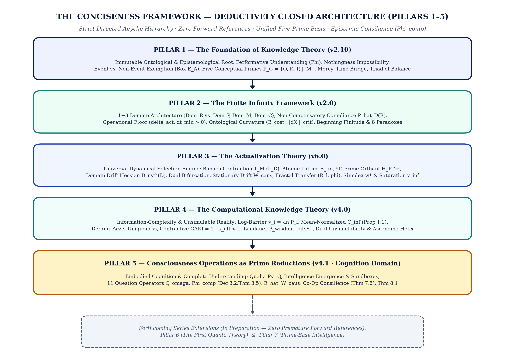

# The Conciseness Framework

**A Deductively Closed Scientific & Philosophical Architecture Spanning Epistemology, Modal Ontology, Domain Boundaries, Dynamical Selection, Computational Complexity, and Embodied Cognition (Pillars 1–5)**

[](https://creativecommons.org/licenses/by/4.0/)
[](LICENSE)
[](https://orcid.org/0009-0006-3991-1153)
[](requirements.txt)

---

## Author & Metadata

* **Author:** Mohamed Gamal Eldin Abdelaziz Noureldin, *Independent Researcher*
* **ORCID:** [0009-0006-3991-1153](https://orcid.org/0009-0006-3991-1153)
* **Contact:** `mz.gamal@gmail.com`
* **Repository:** [https://github.com/mzgamal-space/The-Conciseness-Framework](https://github.com/mzgamal-space/The-Conciseness-Framework)
* **Publication Release:** November 2026 (Canonical Core & Cognition Release: Pillars 1–5)
* **Dual License:** Monographs & Figures under **CC-BY 4.0** · Validation Python Code under **MIT** (see [`LICENSE`](LICENSE))

---

## Executive Overview

**The Conciseness Framework** establishes a strictly progressive, deductively closed **Directed Acyclic Architecture (DAG)** across five completed peer-review-calibrated monographs (**Pillars 1–5**). Every pillar satisfies five architectural invariants:
1. **Immutable Root Grounding:** Every downstream theorem traces back without circularity to Pillar 1's performative and modal axioms.
2. **Zero Forward References:** No pillar imports, anticipates, or depends upon any downstream pillar.
3. **Single Source of Truth (SSOT) & Zero-Collision Symbol Namespace:** Every mathematical operator, physical/information unit, and epistemic threshold is owned by exactly one pillar.
4. **Five-Tier Epistemic Calibration (`[T1]`–`[T5]`):** Every proposition explicitly distinguishes `[T1]` axioms, `[T2]` deductive theorems, `[T3]` modeling bridges, `[T4]` literature/numerically verified conditionals, and `[T5]` open empirical conjectures.
5. **Executable Mathematical Reproducibility:** Every numerical claim, calculus derivation, simulation, and graph in Pillars 1–5 is independently verified by standalone Python validation scripts included in this repository.



---

## Monograph & Verification Directory (Pillars 1–5)

| Pillar | Monograph Title & Version | Domain Role | Monograph PDF | Validation Script | Verified Figures |
| :---: | :--- | :--- | :--- | :--- | :--- |
| **Std** | **Complete Understanding & Epistemic Consilience Standard** (`v1.1`) | Cross-Pillar `Φ_comp` Consilience Standard | [`Complete_Understanding_and_Epistemic_Consilience_Standard_v1.1.pdf`](00_Consilience_Standard/Complete_Understanding_and_Epistemic_Consilience_Standard_v1.1.pdf) | [`validate_consilience_standard.py`](00_Consilience_Standard/validate_consilience_standard.py) | [`README`](00_Consilience_Standard/README.md) · 2 Figs |
| **P1** | **The Foundation of Knowledge Theory** (`v2.10`) | Ontological & Epistemic Root | [`The_Foundation_of_Knowledge_Theory_v2.10.pdf`](01_Foundation_of_Knowledge/The_Foundation_of_Knowledge_Theory_v2.10.pdf) | [`validate_pillar1_foundation.py`](01_Foundation_of_Knowledge/validate_pillar1_foundation.py) | [`README`](01_Foundation_of_Knowledge/README.md) · 2 Figs |
| **P2** | **The Finite Infinity Framework** (`v2.0`) | Domain Epistemology & Curvature Horizon | [`The_Finite_Infinity_Framework_v2.0.pdf`](02_Finite_Infinity_Framework/The_Finite_Infinity_Framework_v2.0.pdf) | [`validate_pillar2_finite_infinity.py`](02_Finite_Infinity_Framework/validate_pillar2_finite_infinity.py) | [`README`](02_Finite_Infinity_Framework/README.md) · 2 Figs |
| **P3** | **The Actualization Theory** (`v6.0`) | Universal Dynamical Selection Engine | [`The_Actualization_Theory_v6.0.pdf`](03_Actualization_Theory/The_Actualization_Theory_v6.0.pdf) | [`validate_pillar3_actualization.py`](03_Actualization_Theory/validate_pillar3_actualization.py) | [`README`](03_Actualization_Theory/README.md) · 2 Figs |
| **P4** | **The Computational Knowledge Theory** (`v4.0`) | Complexity, Compression & Unsimulable Reality | [`The_Computational_Knowledge_Theory_v4.0.pdf`](04_Computational_Knowledge_Theory/The_Computational_Knowledge_Theory_v4.0.pdf) | [`validate_pillar4_ckt.py`](04_Computational_Knowledge_Theory/validate_pillar4_ckt.py) | [`README`](04_Computational_Knowledge_Theory/README.md) · 2 Figs |
| **P5** | **Consciousness Operations as Prime Reductions** (`v4.1`) | Embodied Cognition & Knowledge-Density Engine | [`Consciousness_Operations_as_Prime_Reductions_v4.1.pdf`](05_Consciousness_Prime_Reductions/Consciousness_Operations_as_Prime_Reductions_v4.1.pdf) | [`validate_pillar5_consciousness.py`](05_Consciousness_Prime_Reductions/validate_pillar5_consciousness.py) | [`README`](05_Consciousness_Prime_Reductions/README.md) · 3 Figs |

---

## Reproducibility Quickstart

All mathematical proofs, finite-model Kripke checks, complex-step calculus audits, deterministic propositional verification loops, Monte Carlo bounds, and high-DPI figures (`.png` at 300 DPI and vector `.svg`) are fully reproducible using Python 3.10+ with `numpy` and `matplotlib`.

```bash
git clone https://github.com/mzgamal-space/The-Conciseness-Framework.git
cd The-Conciseness-Framework
pip install -r requirements.txt
python run_all_validations.py
```

Running `python run_all_validations.py` executes:
1. Generation of the architectural schematic (`figures/fig0_framework_architecture_dag.png/.svg`).
2. **Pillar 1 (`validate_pillar1_foundation.py`):** Exhaustive finite-model Kripke verification across 238 reflexive-symmetric B/S5 frames, full-rank 5-Prime Complementary Annihilation matrix checks, Landauer thermodynamic bounds, Mercy–Time Banach contraction decay, and 3D Ascending Epistemic Helix verification.
3. **Pillar 2 (`validate_pillar2_finite_infinity.py`):** Proposition 3.1 conjunctive vs. linear compliance comparison, complex-step exact verification (`< 1e-12` error) of gradient and Hessian curvature, Wigner tangent alignment, and $(1-\sigma)^{-3}$ critical-horizon divergence.
4. **Pillar 3 (`validate_pillar3_actualization.py`):** Canonical Hessian spectrum $\{0.4^4, 8.0\}$ ($\mathrm{Tr}=9.6$), pitchfork boundary at $\alpha^T W_D \alpha = 0.90$, domain pullback $B_{\mathrm{cost}}^{(D)} \succ 0$, cubic Taylor unification ($\mathcal{O}(\|\delta\alpha\|^3)$), IFS Hausdorff pruning, isomorphic pullback $\varphi$, contractive simplex convergence $\mathbf{w}_t \to \mathbf{w}^*$, and saturation ceiling $v_\infty$.
5. **Pillar 4 (`validate_pillar4_ckt.py`):** Log-barrier & mean-normalized coarse-graining equivalence (`< 1e-12`), deterministic 9-rule Propositional Back-and-Forth verification (`3.3333x` linear / `3.5236x` log penalty ratio), 10,000-sample Contractive $\mathrm{CAKI} < 1 - k_{\min}$, Clarke directional derivatives (`< 1e-7`), and closed-loop collapse vs. open ascending helix.
6. **Pillar 5 (`validate_pillar5_consciousness.py`):** Tests 1–9 covering sensory validation divergence, 11 canonical Question Operators with strictly monotonic epistemic aperture $\alpha_\omega \in [5.10^\circ, 58.17^\circ]$, finite-budget non-commutativity, $11\times 11$ Pareto excess, Complete Operational Understanding ($\Phi_{\mathrm{comp}}$, `Def 3.2`, `Thm 3.5`), 5,000-sample joint $\hat{E}+\mathcal{Q}_\omega$ Dykstra projection, Emergence of Intelligence regimes, multi-horizon $W_{\mathrm{caus}}$ trap rejection under $W_e \ge W_p$, Epistemic Co-Operation Consilience (`Thm 7.5`), and Master Theorem 8.1 exact analytic log-derivative (`< 5e-10`) + 9-Tool Knowledge-Density Ablation.
7. **Cross-Pillar Standard (`00_Consilience_Standard/validate_consilience_standard.py`):** Verifies 110/110 off-diagonal Blind-Man Pareto excess pairs, 5×11 P1–P5 Co-Operation partition closure, Strict Leontief vs. Graded Diagnostic discrimination (`U_strict`, `U_graded`), and 5-regime $\mathrm{CAKI}_{\mathrm{P1\text{-}P5}}$ trajectories beneath coupled ceiling $v_\infty = 0.9302$.

---

## Verified Primary Literature Corpus (`arXiv`)

Each monograph positions its mathematical results against primary peer-reviewed and preprint literature retrieved and verified directly via the arXiv API (`literature-search-arxiv` workflow; Terms of Use at [https://info.arxiv.org/help/api/index.html](https://info.arxiv.org/help/api/index.html)).
* **License & Attribution Notice:** [`.licenses/literature_search_arxiv_LICENSE.txt`](.licenses/literature_search_arxiv_LICENSE.txt)
* **Consolidated Corpus Manifest (`211` unique verified arXiv records across Pillars 1–5):** [`citations/verified_arxiv_corpus_p1_to_p5.json`](citations/verified_arxiv_corpus_p1_to_p5.json)

---

## How to Cite

A machine-readable [`CITATION.cff`](CITATION.cff) is included at the repository root.

```bibtex
@misc{noureldin2026conciseness,
  author       = {Noureldin, Mohamed Gamal Eldin Abdelaziz},
  title        = {The Conciseness Framework: Pillars 1--5 Monographs, Mathematical Proofs, and Numerical Validations},
  year         = {2026},
  month        = nov,
  howpublished = {\url{https://github.com/mzgamal-space/The-Conciseness-Framework}},
  note         = {ORCID: 0009-0006-3991-1153. Dual License: CC-BY 4.0 (Monographs/Figures) and MIT (Code)}
}
```

---

## Forthcoming Series Releases

* **Pillar 6 — *The First Quanta Theory*** and **Pillar 7 — *Prime-Base Intelligence*** are forthcoming installments in *The Conciseness Framework* and will be added to this repository upon completion of their peer-review calibration and verification gates.
